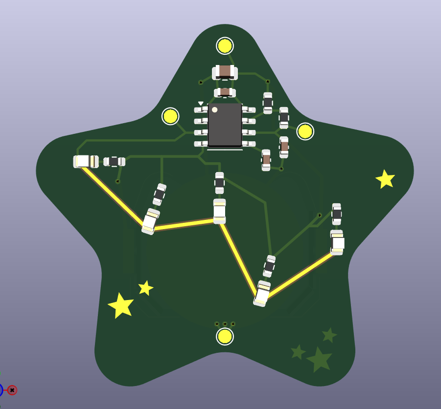
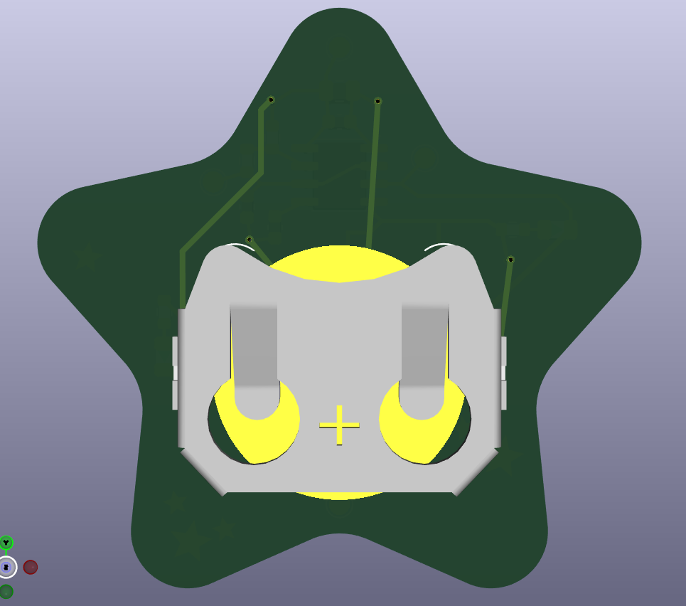
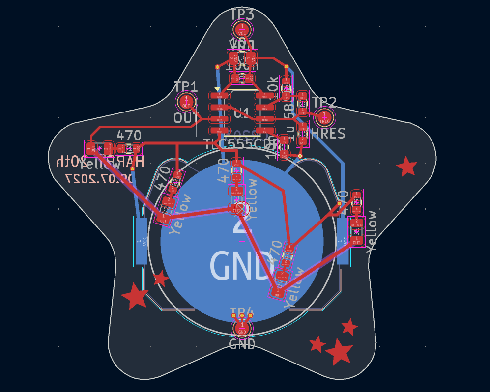
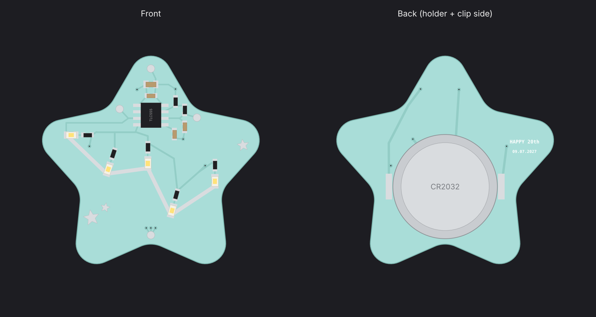
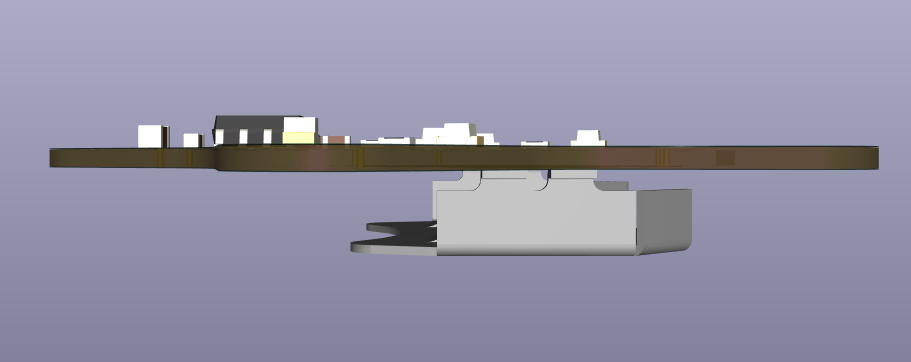
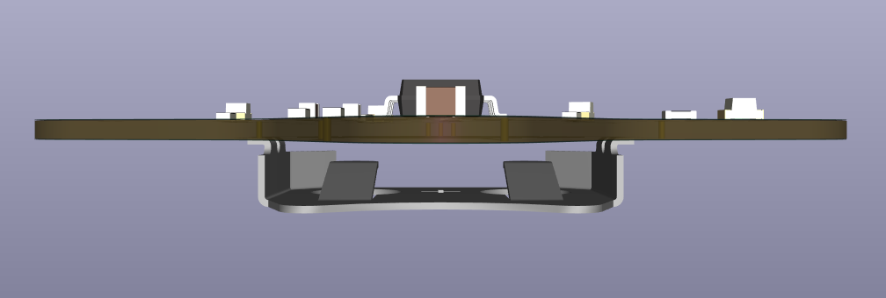
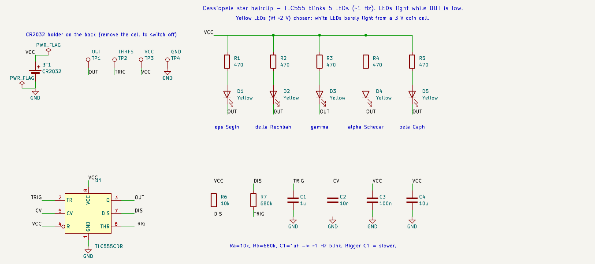

<div align="center">

# ✨ Cassiopeia Star Hairclip

**A wearable PCB that blinks the Cassiopeia constellation, made as a birthday gift.**




</div>

---

## 🌟 What it is

A puffy, rounded star-shaped PCB that clips into your hair. The five stars of **Cassiopeia** (the "W") are yellow LEDs joined by exposed silver traces. A **TLC555** timer makes them twinkle about once a second, and a **CR2032** coin cell on the back powers it.

The traces that draw the constellation are also part of the circuit: they're the 555's output net, so every LED cathode connects through them.

<table>
<tr>
<td align="center"><br><sub><b>Front</b>: LEDs, timer, constellation</sub></td>
<td align="center"><br><sub><b>Back</b>: CR2032 holder</sub></td>
</tr>
<tr>
<td align="center"><br><sub><b>Layout</b> in KiCad</sub></td>
<td align="center"><br><sub><b>Concept render</b>: pastel mask + silver HASL</sub></td>
</tr>
</table>

<p align="center">


<br><sub>Side profiles: about 1 mm board plus the coin cell holder</sub>
</p>

---

## ⚡ How it works



| Block | What it does |
|---|---|
| **U1 · TLC555** | CMOS 555 timer in astable mode. Its low quiescent current suits a coin cell. |
| **R6 · R7 · C1** | Set the blink rate: f ≈ 1.44 / ((R6 + 2·R7)·C1) ≈ **1 Hz** |
| **D1–D5 + R1–R5** | Five yellow LEDs, each with its own 470 Ω resistor. They light while OUT is low. |
| **C3 · C4** | Supply decoupling (100 nF + 10 µF). |
| **C2** | Decouples the 555's CONT pin. |
| **TP1–TP4** | Round test pads for OUT, THRES, VDD and GND. |
| **BT1** | Keystone 3034 SMD CR2032 holder on the back. |

> 💡 **Why yellow LEDs?** A CR2032 gives about 3 V. White and blue LEDs need about 3 V themselves, so they'd barely glow. Yellow, amber and red (Vf ≈ 2 V) run bright.

### The constellation

| LED | Star | Name |
|---|---|---|
| D1 | ε Cas | Segin |
| D2 | δ Cas | Ruchbah |
| D3 | γ Cas | Navi |
| D4 | α Cas | Schedar |
| D5 | β Cas | Caph |

---

## 🛠️ Build it yourself

### 1 · Order the board
Upload [`fabrication/star_clip_gerbers.zip`](fabrication/star_clip_gerbers.zip) to any PCB fab.

| Setting | Value |
|---|---|
| Layers | 2 |
| Thickness | **1.0 mm** (lighter in hair) |
| Solder mask | Pastel / light blue (ask the fab), or white |
| Silkscreen | White |
| Surface finish | **Lead-free HASL** (keeps the lines silver) |

### 2 · Parts list

| Ref | Part | Package | Qty |
|---|---|---|---|
| U1 | TLC555CDR timer | SOIC-8 | 1 |
| D1–D5 | Yellow LED | 0805 | 5 |
| R1–R5 | 470 Ω | 0603 | 5 |
| R6 | 10 kΩ | 0603 | 1 |
| R7 | 680 kΩ | 0603 | 1 |
| C1 | 1 µF | 0603 | 1 |
| C2 | 10 nF | 0603 | 1 |
| C3 | 100 nF | 0603 | 1 |
| C4 | 10 µF | 0805 | 1 |
| BT1 | Keystone 3034 CR2032 holder | SMD | 1 |
| — | CR2032 cell + metal snap/alligator hair clip | — | 1 |

JLCPCB-style [`BOM_JLC.csv`](fabrication/BOM_JLC.csv) and [`CPL_JLC.csv`](fabrication/CPL_JLC.csv) are included if you want it assembled. Add the LCSC part numbers to the BOM first.

### 3 · Solder & assemble
1. Solder the front parts first: the 555, then the passives, then the LEDs. **Watch LED polarity**: the cathode goes to the silver constellation line.
2. Flip the board and solder the CR2032 holder to the back.
3. Pop in a CR2032 and it should start blinking.
4. Glue a metal hair clip across the back with epoxy or E6000.

---

## 🎛️ Tweaks

| Want… | Change |
|---|---|
| Slower twinkle | C1 → 2.2 µF |
| Faster twinkle | C1 → 470 nF |
| Brighter LEDs | R1–R5 → 330 Ω |
| Longer battery life | R1–R5 → 1 kΩ |
| Turn it off | Remove the coin cell |

---

## 📁 Files

```
cassiopeia-star-hairclip/
├── kicad/
│   ├── star_clip.kicad_pro      ← open this in KiCad 10
│   ├── star_clip.kicad_sch
│   ├── star_clip.kicad_pcb
│   └── schematic.pdf
├── fabrication/
│   ├── star_clip_gerbers.zip    ← upload this to the fab
│   ├── gerbers/                 (individual Gerber + drill files)
│   ├── BOM_JLC.csv
│   └── CPL_JLC.csv
└── images/
```

---

<div align="center">

Designed by **[Anuj Kumar](https://github.com/ajkumar-1907)** · Electrical Engineering @ DTU

<sub>Inspired by a star-hairclip build video I came across. This layout, circuit and constellation placement were drawn from scratch in KiCad.</sub>

⭐ If you build one, star the repo!

</div>
